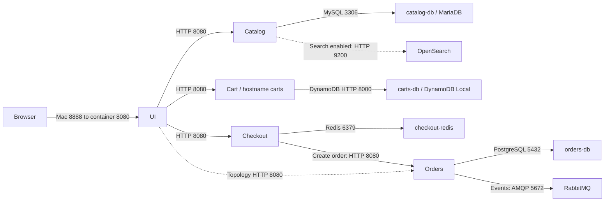

# Services (v1.6.3)

## Overview

- AWS's Retail Store Sample App, pinned at `v1.6.3`, runs locally as five application services and six supporting services.
- The browser enters through UI on Mac port `8888`; application-to-application HTTP uses container port `8080`.
- Each backend owns its data store; orders also publishes events to RabbitMQ.
- OpenSearch provides optional search, while the release Compose configuration always starts it.

<!-- Sources:
[release Compose, lines 6-328](https://github.com/aws-containers/retail-store-sample-app/releases/download/v1.6.3/docker-compose.yaml)
[src/catalog/main.go:83-101](https://github.com/aws-containers/retail-store-sample-app/blob/v1.6.3/src/catalog/main.go#L83-L101)
[src/orders/src/main/java/com/amazon/sample/orders/messaging/rabbitmq/RabbitMQMessagingProvider.java:33-39](https://github.com/aws-containers/retail-store-sample-app/blob/v1.6.3/src/orders/src/main/java/com/amazon/sample/orders/messaging/rabbitmq/RabbitMQMessagingProvider.java#L33-L39)
-->

## Dependencies diagram

- Arrows show callers → dependencies, not response traffic or execution order; dotted arrows indicate optional/diagnostic paths.

<!-- Sources:
[release Compose, lines 15-21](https://github.com/aws-containers/retail-store-sample-app/releases/download/v1.6.3/docker-compose.yaml); [release Compose, lines 68-86](https://github.com/aws-containers/retail-store-sample-app/releases/download/v1.6.3/docker-compose.yaml); [release Compose, lines 140-143](https://github.com/aws-containers/retail-store-sample-app/releases/download/v1.6.3/docker-compose.yaml); [release Compose, lines 218-229](https://github.com/aws-containers/retail-store-sample-app/releases/download/v1.6.3/docker-compose.yaml); [release Compose, lines 302-326](https://github.com/aws-containers/retail-store-sample-app/releases/download/v1.6.3/docker-compose.yaml)
[src/ui/src/main/java/com/amazon/sample/ui/config/StoreServices.java:80-129](https://github.com/aws-containers/retail-store-sample-app/blob/v1.6.3/src/ui/src/main/java/com/amazon/sample/ui/config/StoreServices.java#L80-L129)
[src/ui/src/main/java/com/amazon/sample/ui/web/TopologyController.java:43-52](https://github.com/aws-containers/retail-store-sample-app/blob/v1.6.3/src/ui/src/main/java/com/amazon/sample/ui/web/TopologyController.java#L43-L52)
[src/catalog/main.go:83-101](https://github.com/aws-containers/retail-store-sample-app/blob/v1.6.3/src/catalog/main.go#L83-L101)
[src/checkout/src/checkout/orders/HttpOrdersService.ts:23-47](https://github.com/aws-containers/retail-store-sample-app/blob/v1.6.3/src/checkout/src/checkout/orders/HttpOrdersService.ts#L23-L47)
[src/orders/src/main/java/com/amazon/sample/orders/config/DataSourceConfig.java:26-44](https://github.com/aws-containers/retail-store-sample-app/blob/v1.6.3/src/orders/src/main/java/com/amazon/sample/orders/config/DataSourceConfig.java#L26-L44)
[src/orders/src/main/java/com/amazon/sample/orders/messaging/rabbitmq/RabbitMQMessagingProvider.java:33-39](https://github.com/aws-containers/retail-store-sample-app/blob/v1.6.3/src/orders/src/main/java/com/amazon/sample/orders/messaging/rabbitmq/RabbitMQMessagingProvider.java#L33-L39)
-->

## Order flow

When a customer browses, the UI asks the catalog service for products, which
reads them from MariaDB. Adding an item stores it in DynamoDB Local through
the cart service. During checkout, the checkout service keeps the checkout
state in Redis. Submitting the order makes checkout call the orders service,
which saves the order in PostgreSQL and publishes an event to RabbitMQ.

- Browse: browser → UI → catalog → MariaDB; UI renders the products returned by catalog.
- Add to cart: UI fetches product details/price from catalog, then sends item ID, quantity and unit price to cart → DynamoDB Local.
- Begin checkout: UI reads cart, enriches its items using catalog, then sends the items to checkout → Redis.
- Address/delivery: UI updates checkout; checkout stores the state in Redis, calculates totals and uses internal mock shipping rates.
- Submit: UI validates the demo payment form and calls checkout; checkout loads Redis state and calls orders → PostgreSQL. Orders publishes an order-created event to RabbitMQ through its event handler.
- Confirmation: checkout removes its Redis record and returns a summary; UI deletes the cart and renders the order page. Cleanup sequencing is described under Operational findings.

<!-- Sources:
[src/ui/src/main/java/com/amazon/sample/ui/web/CatalogController.java:57-88](https://github.com/aws-containers/retail-store-sample-app/blob/v1.6.3/src/ui/src/main/java/com/amazon/sample/ui/web/CatalogController.java#L57-L88)
[src/ui/src/main/java/com/amazon/sample/ui/services/catalog/KiotaCatalogService.java:42-76](https://github.com/aws-containers/retail-store-sample-app/blob/v1.6.3/src/ui/src/main/java/com/amazon/sample/ui/services/catalog/KiotaCatalogService.java#L42-L76)
[src/catalog/repository/repository.go:123-151](https://github.com/aws-containers/retail-store-sample-app/blob/v1.6.3/src/catalog/repository/repository.go#L123-L151)
[src/ui/src/main/java/com/amazon/sample/ui/services/carts/KiotaCartsService.java:44-74](https://github.com/aws-containers/retail-store-sample-app/blob/v1.6.3/src/ui/src/main/java/com/amazon/sample/ui/services/carts/KiotaCartsService.java#L44-L74); [src/ui/src/main/java/com/amazon/sample/ui/services/carts/KiotaCartsService.java:88-112](https://github.com/aws-containers/retail-store-sample-app/blob/v1.6.3/src/ui/src/main/java/com/amazon/sample/ui/services/carts/KiotaCartsService.java#L88-L112)
[src/cart/src/main/java/com/amazon/sample/carts/services/DynamoDBCartService.java:125-131](https://github.com/aws-containers/retail-store-sample-app/blob/v1.6.3/src/cart/src/main/java/com/amazon/sample/carts/services/DynamoDBCartService.java#L125-L131); [src/cart/src/main/java/com/amazon/sample/carts/services/DynamoDBCartService.java:140-159](https://github.com/aws-containers/retail-store-sample-app/blob/v1.6.3/src/cart/src/main/java/com/amazon/sample/carts/services/DynamoDBCartService.java#L140-L159)
[src/ui/src/main/java/com/amazon/sample/ui/services/checkout/KiotaCheckoutService.java:61-137](https://github.com/aws-containers/retail-store-sample-app/blob/v1.6.3/src/ui/src/main/java/com/amazon/sample/ui/services/checkout/KiotaCheckoutService.java#L61-L137)
[src/ui/src/main/java/com/amazon/sample/ui/web/CheckoutController.java:75-112](https://github.com/aws-containers/retail-store-sample-app/blob/v1.6.3/src/ui/src/main/java/com/amazon/sample/ui/web/CheckoutController.java#L75-L112); [src/ui/src/main/java/com/amazon/sample/ui/web/CheckoutController.java:130-190](https://github.com/aws-containers/retail-store-sample-app/blob/v1.6.3/src/ui/src/main/java/com/amazon/sample/ui/web/CheckoutController.java#L130-L190)
[src/checkout/src/checkout/checkout.service.ts:49-121](https://github.com/aws-containers/retail-store-sample-app/blob/v1.6.3/src/checkout/src/checkout/checkout.service.ts#L49-L121)
[src/checkout/src/checkout/checkout.module.ts:31-48](https://github.com/aws-containers/retail-store-sample-app/blob/v1.6.3/src/checkout/src/checkout/checkout.module.ts#L31-L48)
[src/checkout/src/checkout/shipping/MockShippingService.ts:23-43](https://github.com/aws-containers/retail-store-sample-app/blob/v1.6.3/src/checkout/src/checkout/shipping/MockShippingService.ts#L23-L43)
[src/checkout/src/checkout/orders/HttpOrdersService.ts:30-47](https://github.com/aws-containers/retail-store-sample-app/blob/v1.6.3/src/checkout/src/checkout/orders/HttpOrdersService.ts#L30-L47)
[src/orders/src/main/java/com/amazon/sample/orders/services/OrderService.java:44-61](https://github.com/aws-containers/retail-store-sample-app/blob/v1.6.3/src/orders/src/main/java/com/amazon/sample/orders/services/OrderService.java#L44-L61)
[src/orders/src/main/java/com/amazon/sample/orders/messaging/OrdersEventHandler.java:38-51](https://github.com/aws-containers/retail-store-sample-app/blob/v1.6.3/src/orders/src/main/java/com/amazon/sample/orders/messaging/OrdersEventHandler.java#L38-L51)
[src/orders/src/main/java/com/amazon/sample/orders/messaging/rabbitmq/RabbitMQMessagingProvider.java:33-39](https://github.com/aws-containers/retail-store-sample-app/blob/v1.6.3/src/orders/src/main/java/com/amazon/sample/orders/messaging/rabbitmq/RabbitMQMessagingProvider.java#L33-L39)
[src/ui/src/main/java/com/amazon/sample/ui/web/TopologyController.java:43-52](https://github.com/aws-containers/retail-store-sample-app/blob/v1.6.3/src/ui/src/main/java/com/amazon/sample/ui/web/TopologyController.java#L43-L52)
[src/ui/src/main/resources/templates/order.html:50-64](https://github.com/aws-containers/retail-store-sample-app/blob/v1.6.3/src/ui/src/main/resources/templates/order.html#L50-L64)
-->

## Application services

### UI (`ui`)

- Purpose / language: renders the storefront and coordinates browser actions; Java, Spring.
- Ports: `8080` / `8888`.
- Calls: `catalog:8080`, `carts:8080` (Compose service `cart`), `checkout:8080`; `orders:8080` for topology diagnostics.
- Called by: browser.
- Data store: no external database configured; browser cookie `SESSIONID` identifies the shopping session.
- Health: HTTP `/actuator/health`, every 10s.
- Metrics: HTTP `/actuator/prometheus` on `8080`.
- Key env: `RETAIL_UI_ENDPOINTS_{CATALOG,CARTS,CHECKOUT,ORDERS}` configure those URLs; `RETAIL_UI_SEARCH_ENABLED=${SEARCH_ENABLED:-false}`; `JAVA_OPTS=-XX:MaxRAMPercentage=75.0 -Djava.security.egd=file:/dev/urandom`.
- Observed memory: **321.8 MiB**.

<!-- Sources:
[release Compose, lines 282-328](https://github.com/aws-containers/retail-store-sample-app/releases/download/v1.6.3/docker-compose.yaml)
[src/ui/chart/values.yaml:40-85](https://github.com/aws-containers/retail-store-sample-app/blob/v1.6.3/src/ui/chart/values.yaml#L40-L85)
[src/ui/src/main/resources/application.yml:1-24](https://github.com/aws-containers/retail-store-sample-app/blob/v1.6.3/src/ui/src/main/resources/application.yml#L1-L24); [src/ui/src/main/resources/application.yml:70-74](https://github.com/aws-containers/retail-store-sample-app/blob/v1.6.3/src/ui/src/main/resources/application.yml#L70-L74)
[src/ui/src/main/java/com/amazon/sample/ui/config/StoreServices.java:80-129](https://github.com/aws-containers/retail-store-sample-app/blob/v1.6.3/src/ui/src/main/java/com/amazon/sample/ui/config/StoreServices.java#L80-L129)
[src/ui/src/main/java/com/amazon/sample/ui/web/TopologyController.java:43-61](https://github.com/aws-containers/retail-store-sample-app/blob/v1.6.3/src/ui/src/main/java/com/amazon/sample/ui/web/TopologyController.java#L43-L61)
[src/ui/src/main/java/com/amazon/sample/ui/web/util/TopologyService.java:57-119](https://github.com/aws-containers/retail-store-sample-app/blob/v1.6.3/src/ui/src/main/java/com/amazon/sample/ui/web/util/TopologyService.java#L57-L119)
[src/ui/src/main/java/com/amazon/sample/ui/web/util/SessionIDUtil.java:26-50](https://github.com/aws-containers/retail-store-sample-app/blob/v1.6.3/src/ui/src/main/java/com/amazon/sample/ui/web/util/SessionIDUtil.java#L26-L50)
-->

### Catalog (`catalog`)

- Purpose / language: product listing, details and optional search; Go, Gin.
- Ports: `8080` / none.
- Calls: `catalog-db:3306`; `opensearch:9200` only when search is enabled.
- Called by: UI.
- Data store: MariaDB, database `catalogdb`; optional OpenSearch index `products`.
- Health: HTTP `/health`, every 10s.
- Metrics: HTTP `/metrics` on `8080`.
- Key env: `RETAIL_CATALOG_PERSISTENCE_PROVIDER=mysql`, `RETAIL_CATALOG_PERSISTENCE_ENDPOINT=catalog-db:3306`, `RETAIL_CATALOG_PERSISTENCE_PASSWORD=${DB_PASSWORD}`; `RETAIL_CATALOG_SEARCH_ENABLED=${SEARCH_ENABLED:-false}`, `RETAIL_CATALOG_SEARCH_OS_ENDPOINT=http://opensearch:9200`.
- Observed memory: **33.82 MiB**.

<!-- Sources:
[release Compose, lines 65-101](https://github.com/aws-containers/retail-store-sample-app/releases/download/v1.6.3/docker-compose.yaml); [release Compose, lines 102-125](https://github.com/aws-containers/retail-store-sample-app/releases/download/v1.6.3/docker-compose.yaml)
[src/catalog/chart/values.yaml:38-40](https://github.com/aws-containers/retail-store-sample-app/blob/v1.6.3/src/catalog/chart/values.yaml#L38-L40); [src/catalog/chart/values.yaml:64-105](https://github.com/aws-containers/retail-store-sample-app/blob/v1.6.3/src/catalog/chart/values.yaml#L64-L105); [src/catalog/chart/values.yaml:124-133](https://github.com/aws-containers/retail-store-sample-app/blob/v1.6.3/src/catalog/chart/values.yaml#L124-L133)
[src/catalog/config/config.go:20-44](https://github.com/aws-containers/retail-store-sample-app/blob/v1.6.3/src/catalog/config/config.go#L20-L44)
[src/catalog/main.go:78-114](https://github.com/aws-containers/retail-store-sample-app/blob/v1.6.3/src/catalog/main.go#L78-L114); [src/catalog/main.go:130-145](https://github.com/aws-containers/retail-store-sample-app/blob/v1.6.3/src/catalog/main.go#L130-L145); [src/catalog/main.go:160-163](https://github.com/aws-containers/retail-store-sample-app/blob/v1.6.3/src/catalog/main.go#L160-L163)
[src/catalog/repository/repository.go:27-58](https://github.com/aws-containers/retail-store-sample-app/blob/v1.6.3/src/catalog/repository/repository.go#L27-L58)
[src/catalog/repository/opensearch.go:67-105](https://github.com/aws-containers/retail-store-sample-app/blob/v1.6.3/src/catalog/repository/opensearch.go#L67-L105)
-->

### Cart (`cart`, hostname `carts`)

- Purpose / language: stores shopping-cart items, quantities and unit prices; Java, Spring.
- Ports: `8080` / none.
- Calls: `carts-db:8000`; product lookup happens in the UI, rather than in the cart backend.
- Called by: UI.
- Data store: DynamoDB Local, table `Items`.
- Health: HTTP `/actuator/health`, every 10s.
- Metrics: HTTP `/actuator/prometheus` on `8080`.
- Key env: `RETAIL_CART_PERSISTENCE_PROVIDER=dynamodb`, `RETAIL_CART_PERSISTENCE_DYNAMODB_ENDPOINT=http://carts-db:8000`, `RETAIL_CART_PERSISTENCE_DYNAMODB_CREATE_TABLE=true`; local credentials `AWS_ACCESS_KEY_ID=key`, `AWS_SECRET_ACCESS_KEY=dummy`.
- Observed memory: **266.1 MiB**.

<!-- Sources:
[release Compose, lines 6-40](https://github.com/aws-containers/retail-store-sample-app/releases/download/v1.6.3/docker-compose.yaml)
[src/cart/chart/values.yaml:38-40](https://github.com/aws-containers/retail-store-sample-app/blob/v1.6.3/src/cart/chart/values.yaml#L38-L40); [src/cart/chart/values.yaml:64-92](https://github.com/aws-containers/retail-store-sample-app/blob/v1.6.3/src/cart/chart/values.yaml#L64-L92)
[src/cart/src/main/resources/application.yml:1-17](https://github.com/aws-containers/retail-store-sample-app/blob/v1.6.3/src/cart/src/main/resources/application.yml#L1-L17)
[src/cart/src/main/java/com/amazon/sample/carts/config/DynamoDBConfiguration.java:34-79](https://github.com/aws-containers/retail-store-sample-app/blob/v1.6.3/src/cart/src/main/java/com/amazon/sample/carts/config/DynamoDBConfiguration.java#L34-L79)
[src/cart/src/main/java/com/amazon/sample/carts/services/DynamoDBCartService.java:57-104](https://github.com/aws-containers/retail-store-sample-app/blob/v1.6.3/src/cart/src/main/java/com/amazon/sample/carts/services/DynamoDBCartService.java#L57-L104); [src/cart/src/main/java/com/amazon/sample/carts/services/DynamoDBCartService.java:140-159](https://github.com/aws-containers/retail-store-sample-app/blob/v1.6.3/src/cart/src/main/java/com/amazon/sample/carts/services/DynamoDBCartService.java#L140-L159)
[src/cart/src/main/java/com/amazon/sample/carts/web/CartsController.java:43-71](https://github.com/aws-containers/retail-store-sample-app/blob/v1.6.3/src/cart/src/main/java/com/amazon/sample/carts/web/CartsController.java#L43-L71); [src/cart/src/main/java/com/amazon/sample/carts/web/CartsController.java:113-125](https://github.com/aws-containers/retail-store-sample-app/blob/v1.6.3/src/cart/src/main/java/com/amazon/sample/carts/web/CartsController.java#L113-L125)
[src/ui/src/main/java/com/amazon/sample/ui/services/carts/KiotaCartsService.java:58-74](https://github.com/aws-containers/retail-store-sample-app/blob/v1.6.3/src/ui/src/main/java/com/amazon/sample/ui/services/carts/KiotaCartsService.java#L58-L74); [src/ui/src/main/java/com/amazon/sample/ui/services/carts/KiotaCartsService.java:88-112](https://github.com/aws-containers/retail-store-sample-app/blob/v1.6.3/src/ui/src/main/java/com/amazon/sample/ui/services/carts/KiotaCartsService.java#L88-L112)
-->

### Checkout (`checkout`)

- Purpose / language: tracks checkout details, calculates totals and submits orders; TypeScript, NestJS on Node.js.
- Ports: `8080` / none.
- Calls: `checkout-redis:6379`, `orders:8080`; shipping rates come from an internal mock implementation.
- Called by: UI.
- Data store: Redis, with serialized checkout state keyed by customer/session identifier.
- Health: HTTP `/health`, every 10s.
- Metrics: HTTP `/metrics` on `8080`.
- Key env: `RETAIL_CHECKOUT_PERSISTENCE_PROVIDER=redis`, `RETAIL_CHECKOUT_PERSISTENCE_REDIS_URL=redis://checkout-redis:6379`, `RETAIL_CHECKOUT_ENDPOINTS_ORDERS=http://orders:8080`.
- Observed memory: **76.73 MiB**.

<!-- Sources:
[release Compose, lines 131-159](https://github.com/aws-containers/retail-store-sample-app/releases/download/v1.6.3/docker-compose.yaml)
[src/checkout/chart/values.yaml:38-40](https://github.com/aws-containers/retail-store-sample-app/blob/v1.6.3/src/checkout/chart/values.yaml#L38-L40); [src/checkout/chart/values.yaml:64-95](https://github.com/aws-containers/retail-store-sample-app/blob/v1.6.3/src/checkout/chart/values.yaml#L64-L95)
[src/checkout/src/main.ts:19-31](https://github.com/aws-containers/retail-store-sample-app/blob/v1.6.3/src/checkout/src/main.ts#L19-L31); [src/checkout/src/main.ts:48-50](https://github.com/aws-containers/retail-store-sample-app/blob/v1.6.3/src/checkout/src/main.ts#L48-L50); [src/checkout/src/app.module.ts:26-42](https://github.com/aws-containers/retail-store-sample-app/blob/v1.6.3/src/checkout/src/app.module.ts#L26-L42)
[src/checkout/src/app.controller.ts:24-37](https://github.com/aws-containers/retail-store-sample-app/blob/v1.6.3/src/checkout/src/app.controller.ts#L24-L37); [src/checkout/src/config/configuration.ts:19-34](https://github.com/aws-containers/retail-store-sample-app/blob/v1.6.3/src/checkout/src/config/configuration.ts#L19-L34)
[src/checkout/src/checkout/checkout.module.ts:31-74](https://github.com/aws-containers/retail-store-sample-app/blob/v1.6.3/src/checkout/src/checkout/checkout.module.ts#L31-L74)
[src/checkout/src/checkout/checkout.service.ts:39-121](https://github.com/aws-containers/retail-store-sample-app/blob/v1.6.3/src/checkout/src/checkout/checkout.service.ts#L39-L121)
[src/checkout/src/checkout/repositories/RedisCheckoutRepository.ts:71-96](https://github.com/aws-containers/retail-store-sample-app/blob/v1.6.3/src/checkout/src/checkout/repositories/RedisCheckoutRepository.ts#L71-L96)
[src/checkout/src/checkout/orders/HttpOrdersService.ts:23-47](https://github.com/aws-containers/retail-store-sample-app/blob/v1.6.3/src/checkout/src/checkout/orders/HttpOrdersService.ts#L23-L47)
-->

### Orders (`orders`)

- Purpose / language: creates/lists persisted orders and publishes order-created events; Java, Spring.
- Ports: `8080` / none.
- Calls: `orders-db:5432`, `rabbitmq:5672`.
- Called by: checkout for order creation; UI for topology diagnostics.
- Data store: PostgreSQL, database `orders`.
- Health: HTTP `/actuator/health`, every 10s.
- Metrics: HTTP `/actuator/prometheus` on `8080`.
- Key env: `RETAIL_ORDERS_PERSISTENCE_PROVIDER=postgres`, `RETAIL_ORDERS_PERSISTENCE_ENDPOINT=orders-db:5432`, `RETAIL_ORDERS_PERSISTENCE_NAME=orders`, `RETAIL_ORDERS_PERSISTENCE_USERNAME=orders_user`, `RETAIL_ORDERS_PERSISTENCE_PASSWORD=${DB_PASSWORD}`.
- Key env: `RETAIL_ORDERS_MESSAGING_PROVIDER=rabbitmq`, `RETAIL_ORDERS_MESSAGING_RABBITMQ_ADDRESSES=rabbitmq:5672`, `RETAIL_ORDERS_MESSAGING_RABBITMQ_USERNAME=rabbitmq`, `RETAIL_ORDERS_MESSAGING_RABBITMQ_PASSWORD=${DB_PASSWORD}`.
- Observed memory: **269.8 MiB**.

<!-- Sources:
[release Compose, lines 208-248](https://github.com/aws-containers/retail-store-sample-app/releases/download/v1.6.3/docker-compose.yaml)
[src/orders/chart/values.yaml:38-40](https://github.com/aws-containers/retail-store-sample-app/blob/v1.6.3/src/orders/chart/values.yaml#L38-L40); [src/orders/chart/values.yaml:64-109](https://github.com/aws-containers/retail-store-sample-app/blob/v1.6.3/src/orders/chart/values.yaml#L64-L109); [src/orders/chart/values.yaml:128-141](https://github.com/aws-containers/retail-store-sample-app/blob/v1.6.3/src/orders/chart/values.yaml#L128-L141)
[src/orders/src/main/resources/application.yml:1-12](https://github.com/aws-containers/retail-store-sample-app/blob/v1.6.3/src/orders/src/main/resources/application.yml#L1-L12)
[src/orders/src/main/java/com/amazon/sample/orders/config/DataSourceConfig.java:13-44](https://github.com/aws-containers/retail-store-sample-app/blob/v1.6.3/src/orders/src/main/java/com/amazon/sample/orders/config/DataSourceConfig.java#L13-L44)
[src/orders/src/main/java/com/amazon/sample/orders/web/OrderController.java:37-66](https://github.com/aws-containers/retail-store-sample-app/blob/v1.6.3/src/orders/src/main/java/com/amazon/sample/orders/web/OrderController.java#L37-L66)
[src/orders/src/main/java/com/amazon/sample/orders/services/OrderService.java:34-61](https://github.com/aws-containers/retail-store-sample-app/blob/v1.6.3/src/orders/src/main/java/com/amazon/sample/orders/services/OrderService.java#L34-L61)
[src/orders/src/main/java/com/amazon/sample/orders/messaging/OrdersEventHandler.java:29-51](https://github.com/aws-containers/retail-store-sample-app/blob/v1.6.3/src/orders/src/main/java/com/amazon/sample/orders/messaging/OrdersEventHandler.java#L29-L51)
[src/orders/src/main/java/com/amazon/sample/orders/messaging/rabbitmq/RabbitMQMessagingProvider.java:25-39](https://github.com/aws-containers/retail-store-sample-app/blob/v1.6.3/src/orders/src/main/java/com/amazon/sample/orders/messaging/rabbitmq/RabbitMQMessagingProvider.java#L25-L39)
[src/ui/src/main/java/com/amazon/sample/ui/web/TopologyController.java:43-52](https://github.com/aws-containers/retail-store-sample-app/blob/v1.6.3/src/ui/src/main/java/com/amazon/sample/ui/web/TopologyController.java#L43-L52)
-->

## Supporting services

| Service | Image | Used by | Port (container / published) | Health check | Observed memory |
| --- | --- | --- | --- | --- | ---: |
| `catalog-db` | `mariadb:10.9` | catalog | `3306` / none | `mysqladmin ping`, user `catalog_user`, every 10s | 82.82 MiB |
| `carts-db` | `amazon/dynamodb-local:1.20.0` | cart | `8000` / none | `exit 0`, every 5s | 197.1 MiB |
| `checkout-redis` | `redis:6.0-alpine` | checkout | `6379` / none | `redis-cli ping`, every 1s | 13.18 MiB |
| `orders-db` | `postgres:16.1` | orders | `5432` / none | `pg_isready -d orders -U orders_user`, every 10s | 48.15 MiB |
| `rabbitmq` | `rabbitmq:3-management` | orders | `5672` AMQP, `15672` management HTTP / none | None configured | 157.7 MiB |
| `opensearch` | `opensearchproject/opensearch:3.5.0` | catalog, when search enabled | `9200`, `9600` / `9200`, `9600` | HTTP `9200/_cluster/health`, every 10s | 878.3 MiB |

<!-- Sources:
[release Compose, lines 15-21](https://github.com/aws-containers/retail-store-sample-app/releases/download/v1.6.3/docker-compose.yaml); [release Compose, lines 41-64](https://github.com/aws-containers/retail-store-sample-app/releases/download/v1.6.3/docker-compose.yaml); [release Compose, lines 68-86](https://github.com/aws-containers/retail-store-sample-app/releases/download/v1.6.3/docker-compose.yaml); [release Compose, lines 102-130](https://github.com/aws-containers/retail-store-sample-app/releases/download/v1.6.3/docker-compose.yaml); [release Compose, lines 140-143](https://github.com/aws-containers/retail-store-sample-app/releases/download/v1.6.3/docker-compose.yaml); [release Compose, lines 160-207](https://github.com/aws-containers/retail-store-sample-app/releases/download/v1.6.3/docker-compose.yaml); [release Compose, lines 218-229](https://github.com/aws-containers/retail-store-sample-app/releases/download/v1.6.3/docker-compose.yaml); [release Compose, lines 249-281](https://github.com/aws-containers/retail-store-sample-app/releases/download/v1.6.3/docker-compose.yaml)
[src/catalog/chart/values.yaml:95-105](https://github.com/aws-containers/retail-store-sample-app/blob/v1.6.3/src/catalog/chart/values.yaml#L95-L105); [src/catalog/chart/values.yaml:124-133](https://github.com/aws-containers/retail-store-sample-app/blob/v1.6.3/src/catalog/chart/values.yaml#L124-L133)
[src/cart/chart/values.yaml:82-92](https://github.com/aws-containers/retail-store-sample-app/blob/v1.6.3/src/cart/chart/values.yaml#L82-L92)
[src/checkout/chart/values.yaml:85-95](https://github.com/aws-containers/retail-store-sample-app/blob/v1.6.3/src/checkout/chart/values.yaml#L85-L95)
[src/orders/chart/values.yaml:99-109](https://github.com/aws-containers/retail-store-sample-app/blob/v1.6.3/src/orders/chart/values.yaml#L99-L109); [src/orders/chart/values.yaml:128-141](https://github.com/aws-containers/retail-store-sample-app/blob/v1.6.3/src/orders/chart/values.yaml#L128-L141)
Memory: docker stats snapshot, 2026-10-05, about nine minutes after startup, after one order.
-->

## Operational findings

- **Health-check gaps:** DynamoDB Local's `exit 0` always passes; catalog and checkout check chaos-health state without probing their databases. OpenSearch's probe checks HTTP success, without checking a particular cluster-health color.
- **Broker readiness:** RabbitMQ has no Compose health check; orders waits for PostgreSQL only. A running container does not establish broker readiness.
- **OpenSearch startup dependency:** catalog waits for healthy OpenSearch even with `SEARCH_ENABLED=false`; disabling the search feature does not remove this container or startup gate.
- **Total observed memory:** 2,345.5 MiB (about 2.29 GiB) across all
  11 containers, from one `docker stats` snapshot taken about nine minutes
  after startup, after one order.
- **OpenSearch memory share:** **878.3 MiB, approximately 37.4%** of the observed container total, the largest share. Its configured heap is `512m`; process memory extends beyond that heap.
- **Memory limits:** UI has a Compose limit of `512m`; the other containers have no individual Compose memory limit and share the Docker VM's reported `7.654 GiB` capacity.
- **Cart deletion sequencing:** the generated clients are synchronous, so submission's `.post()` completes before cart deletion is invoked. Their results are combined with `zipWith`; a cart-deletion failure could prevent confirmation after the order was created. This is source analysis, not an injected failure test.
- **Local-only security, OpenSearch:** `plugins.security.disabled=true`; ports `9200` and `9600` are published. Catalog sets `RETAIL_CATALOG_SEARCH_OS_TLS_SKIP_VERIFY=true`.
- **Local-only security, cart:** dummy AWS credentials target the explicitly configured DynamoDB Local HTTP endpoint.
- **Local-only security, databases/broker:** `${DB_PASSWORD}` is shared by MariaDB, PostgreSQL and RabbitMQ; MariaDB also sets `MYSQL_ALLOW_EMPTY_PASSWORD=true`. That flag alone does not prove an empty password is accepted in this run.

<!-- Sources:
[release Compose, lines 15-21](https://github.com/aws-containers/retail-store-sample-app/releases/download/v1.6.3/docker-compose.yaml); [release Compose, lines 48-54](https://github.com/aws-containers/retail-store-sample-app/releases/download/v1.6.3/docker-compose.yaml); [release Compose, lines 68-86](https://github.com/aws-containers/retail-store-sample-app/releases/download/v1.6.3/docker-compose.yaml); [release Compose, lines 103-109](https://github.com/aws-containers/retail-store-sample-app/releases/download/v1.6.3/docker-compose.yaml); [release Compose, lines 175-201](https://github.com/aws-containers/retail-store-sample-app/releases/download/v1.6.3/docker-compose.yaml); [release Compose, lines 213-229](https://github.com/aws-containers/retail-store-sample-app/releases/download/v1.6.3/docker-compose.yaml); [release Compose, lines 270-281](https://github.com/aws-containers/retail-store-sample-app/releases/download/v1.6.3/docker-compose.yaml); [release Compose, lines 302-326](https://github.com/aws-containers/retail-store-sample-app/releases/download/v1.6.3/docker-compose.yaml)
[src/catalog/main.go:138-145](https://github.com/aws-containers/retail-store-sample-app/blob/v1.6.3/src/catalog/main.go#L138-L145)
[src/checkout/src/app.controller.ts:32-37](https://github.com/aws-containers/retail-store-sample-app/blob/v1.6.3/src/checkout/src/app.controller.ts#L32-L37)
[src/ui/src/main/java/com/amazon/sample/ui/services/checkout/KiotaCheckoutService.java:130-137](https://github.com/aws-containers/retail-store-sample-app/blob/v1.6.3/src/ui/src/main/java/com/amazon/sample/ui/services/checkout/KiotaCheckoutService.java#L130-L137)
[src/ui/src/main/java/com/amazon/sample/ui/client/checkout/checkout/item/submit/SubmitRequestBuilder.java:51-76](https://github.com/aws-containers/retail-store-sample-app/blob/v1.6.3/src/ui/src/main/java/com/amazon/sample/ui/client/checkout/checkout/item/submit/SubmitRequestBuilder.java#L51-L76)
[src/ui/src/main/java/com/amazon/sample/ui/services/carts/KiotaCartsService.java:51-55](https://github.com/aws-containers/retail-store-sample-app/blob/v1.6.3/src/ui/src/main/java/com/amazon/sample/ui/services/carts/KiotaCartsService.java#L51-L55); [src/ui/src/main/java/com/amazon/sample/ui/services/carts/KiotaCartsService.java:88-99](https://github.com/aws-containers/retail-store-sample-app/blob/v1.6.3/src/ui/src/main/java/com/amazon/sample/ui/services/carts/KiotaCartsService.java#L88-L99)
[src/ui/src/main/java/com/amazon/sample/ui/client/cart/carts/item/WithCustomerItemRequestBuilder.java:67-95](https://github.com/aws-containers/retail-store-sample-app/blob/v1.6.3/src/ui/src/main/java/com/amazon/sample/ui/client/cart/carts/item/WithCustomerItemRequestBuilder.java#L67-L95)
Memory: docker stats snapshot, 2026-10-05, about nine minutes after startup, after one order.
-->

## Notes and sources

- Local settings come from the [v1.6.3 release Compose file](https://github.com/aws-containers/retail-store-sample-app/releases/download/v1.6.3/docker-compose.yaml); source-file links below are pinned to GitHub tag `v1.6.3`. Release line numbers refer to the downloaded YAML, not a temporary machine path.
- Helm values were cross-checked, but their defaults do not configure this Compose run: chart Services use port `80`; the catalog chart specifies MySQL 8.0, while Compose uses MariaDB 10.9; DynamoDB Local image/tag also differs.
- Application metrics entries describe configured endpoints; their runtime responses are **unverified**. Supporting-service ports list the checked application/management interfaces and explicit Compose mappings.
- Memory readings come from the 2026-10-05 `docker stats` snapshot, about nine minutes after startup, after one order; idle state is **unverified**. Source files establish configuration, not those observed readings.
- Payment is demo form validation and shipping rates are mocked; the order page's “Processing” and “Shipped” labels are static.

<!-- Sources:
[src/app/docker-compose.yml:17-22](https://github.com/aws-containers/retail-store-sample-app/blob/v1.6.3/src/app/docker-compose.yml#L17-L22); [src/app/compose.override.yaml:1-37](https://github.com/aws-containers/retail-store-sample-app/blob/v1.6.3/src/app/compose.override.yaml#L1-L37); [scripts/compose-dist.sh:12-21](https://github.com/aws-containers/retail-store-sample-app/blob/v1.6.3/scripts/compose-dist.sh#L12-L21)
[src/ui/chart/values.yaml:40-42](https://github.com/aws-containers/retail-store-sample-app/blob/v1.6.3/src/ui/chart/values.yaml#L40-L42); [src/ui/chart/values.yaml:68-85](https://github.com/aws-containers/retail-store-sample-app/blob/v1.6.3/src/ui/chart/values.yaml#L68-L85); [src/ui/src/main/resources/application.yml:1-2](https://github.com/aws-containers/retail-store-sample-app/blob/v1.6.3/src/ui/src/main/resources/application.yml#L1-L2); [src/ui/src/main/resources/application.yml:70-74](https://github.com/aws-containers/retail-store-sample-app/blob/v1.6.3/src/ui/src/main/resources/application.yml#L70-L74)
[src/catalog/chart/values.yaml:38-40](https://github.com/aws-containers/retail-store-sample-app/blob/v1.6.3/src/catalog/chart/values.yaml#L38-L40); [src/catalog/chart/values.yaml:64-69](https://github.com/aws-containers/retail-store-sample-app/blob/v1.6.3/src/catalog/chart/values.yaml#L64-L69); [src/catalog/chart/values.yaml:95-105](https://github.com/aws-containers/retail-store-sample-app/blob/v1.6.3/src/catalog/chart/values.yaml#L95-L105)
[src/cart/chart/values.yaml:38-40](https://github.com/aws-containers/retail-store-sample-app/blob/v1.6.3/src/cart/chart/values.yaml#L38-L40); [src/cart/chart/values.yaml:64-92](https://github.com/aws-containers/retail-store-sample-app/blob/v1.6.3/src/cart/chart/values.yaml#L64-L92)
[src/checkout/chart/values.yaml:38-40](https://github.com/aws-containers/retail-store-sample-app/blob/v1.6.3/src/checkout/chart/values.yaml#L38-L40); [src/checkout/chart/values.yaml:64-95](https://github.com/aws-containers/retail-store-sample-app/blob/v1.6.3/src/checkout/chart/values.yaml#L64-L95)
[src/orders/chart/values.yaml:38-40](https://github.com/aws-containers/retail-store-sample-app/blob/v1.6.3/src/orders/chart/values.yaml#L38-L40); [src/orders/chart/values.yaml:64-69](https://github.com/aws-containers/retail-store-sample-app/blob/v1.6.3/src/orders/chart/values.yaml#L64-L69); [src/orders/chart/values.yaml:128-141](https://github.com/aws-containers/retail-store-sample-app/blob/v1.6.3/src/orders/chart/values.yaml#L128-L141)
[src/ui/src/main/java/com/amazon/sample/ui/web/CheckoutController.java:169-190](https://github.com/aws-containers/retail-store-sample-app/blob/v1.6.3/src/ui/src/main/java/com/amazon/sample/ui/web/CheckoutController.java#L169-L190)
[src/checkout/src/checkout/checkout.module.ts:43-48](https://github.com/aws-containers/retail-store-sample-app/blob/v1.6.3/src/checkout/src/checkout/checkout.module.ts#L43-L48)
[src/checkout/src/checkout/shipping/MockShippingService.ts:23-43](https://github.com/aws-containers/retail-store-sample-app/blob/v1.6.3/src/checkout/src/checkout/shipping/MockShippingService.ts#L23-L43)
[src/ui/src/main/resources/templates/order.html:50-64](https://github.com/aws-containers/retail-store-sample-app/blob/v1.6.3/src/ui/src/main/resources/templates/order.html#L50-L64)
-->
